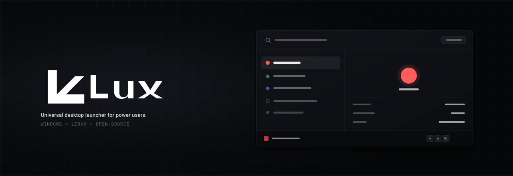
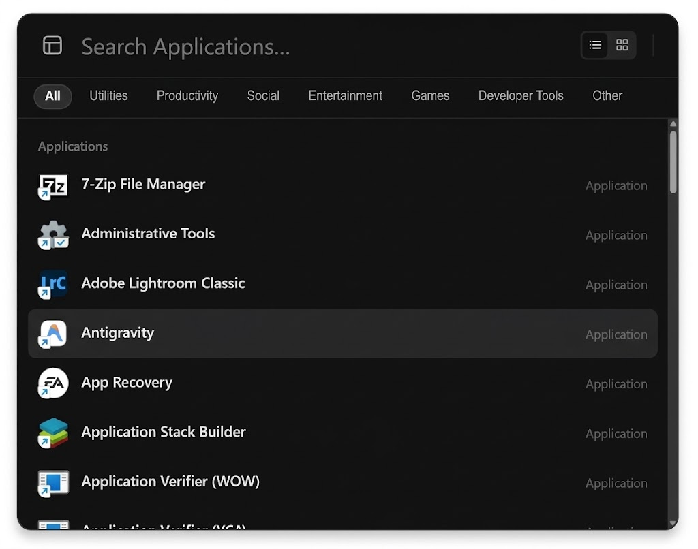
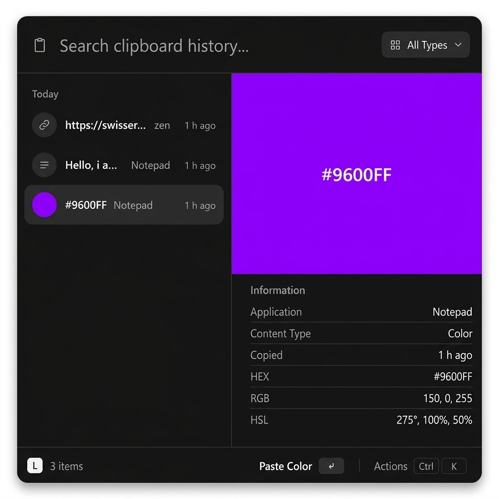

<p align="center">
  
</p>

<p align="center">
  
</p>

<p align="center">
  A faster, more focused way to work on your desktop.
</p>

<p align="center">
  A free, open-source, keyboard-first desktop launcher for Windows and Linux.
</p>

<p align="center">
  <a href="LICENSE"></a>
  
  
  
</p>

---

## Overview

Lux is a keyboard-first desktop launcher designed to make everyday desktop tasks faster and easier to access.

Inspired by tools such as Spotlight and Raycast, Lux brings application launching, local file discovery, instant calculations, unit and currency conversions, and clipboard history into a clean, compact interface that stays out of your way until you need it.

Built with Rust and Tauri 2, Lux combines native desktop integration with a fast, modern Svelte 5 frontend.

> **Note:** Lux is currently in active early development. Features, interfaces, and platform behaviors are evolving. Primary development and testing currently target Windows, with Linux support actively in progress.

## Preview

<table>
  <tr>
    <td align="center" height="10%" width="10%">
      <strong>Launcher</strong><br><br>
      <br>
      <sub>Fast application and local file search with category filters and contextual actions.</sub>
    </td>
    <td align="center" height="10%" width="10%">
      <strong>Clipboard History</strong><br><br>
      <br>
      <sub>Dedicated clipboard manager with automatic privacy filtering for sensitive data.</sub>
    </td>
  </tr>
</table>

<sub><em>Visual previews reflect the current application interface. Screenshot assets are updated alongside milestone releases.</em></sub>

## Current Features

- **Search Anything** — Find and launch installed applications, or search genuine local files and directories using the background Everything search engine or native indexer. Browse dedicated categories (Apps, Files, Actions) with smooth subcategory filtering, progressive loading, and interactive back navigation.
- **Quick Look Previews** — Select any file result in the launcher and press <kbd>Space</kbd> to open a dedicated Quick Look preview window with format-aware metadata, text truncation preview, PDF page detection, archive file listing, image previews, and format badges.
- **Contextual Actions** — Press <kbd>Ctrl</kbd> + <kbd>K</kbd> or **Right-Click** any item in the launcher or clipboard history to inspect and trigger contextual actions, such as running applications as Administrator (<kbd>Ctrl</kbd> + <kbd>Shift</kbd> + <kbd>Enter</kbd>), revealing items in File Explorer (<kbd>Ctrl</kbd> + <kbd>O</kbd>), copying paths, or custom actions.
- **First-Run Welcome & Main Menu** — On first launch after installation, Lux displays an introductory welcome guide explaining how to open and use the launcher, clipboard, and previews. Left-clicking Lux's system tray icon opens the dedicated **Main Menu** organizing settings, privacy filters, keyboard shortcuts, index status, and diagnostics into clean side tabs and subtabs.
- **Quick Answers** — Evaluate mathematical expressions (`(128 * 1.19) / 3`, `sqrt(144)`), compute financial VAT/taxes, split expenses, inspect worldwide time zones and differences, perform calendar day arithmetic, convert units (distinguishing decimal SI and binary IEC digital storage), and inspect color formats (#HEX, RGB, HSL) with visual swatches—all processed offline locally.
- **Currency Conversion** — Convert between 160+ fiat currencies with smart local caching and offline fallback, without transmitting search queries or polling on keystrokes.
- **Clipboard History** — Access your clipboard history in a dedicated window (<kbd>Alt</kbd> + <kbd>Shift</kbd> + <kbd>V</kbd>). Search previous clips, filter by type (text, links, images, colors), and protect sensitive data with built-in filters for API keys, bearer tokens, credit cards, and custom regular expressions.
- **Application Controls & System Tray** — Run silently in the background with minimal idle resource usage. Summon the launcher via a customizable global shortcut (<kbd>Alt</kbd> + <kbd>Space</kbd> by default), dismiss it instantly with <kbd>Esc</kbd> or focus loss, and manage the application via the system tray.
- **Customization & Display Densities** — Tailor the launcher to your preference with three information density modes (`Minimal` Spotlight-style, `Normal`, `Detailed`), three layout padding densities (`Compact`, `Normal`, `Comfortable`), `List` or `Grid` view modes, and `System`, `Light`, or `Dark` themes.
- **Secure Password Generator** — Generate cryptographically random passwords locally on demand (`generate password 24`) that are copied directly to your clipboard without leaving traces or network requests.

For detailed usage instructions, query syntax examples, keyboard shortcuts, and configuration options, see the **[User Feature Guide](docs/features.md)**.

## Design Principles

- **Fast** — Responsive keyboard-first interactions and minimal idle resource footprint.
- **Focused** — Compact interface that stays centered and disappears immediately when dismissed.
- **Local-first** — Local SQLite indexing and offline calculations; user data remains on the local machine.
- **Private by default** — Zero telemetry, no hidden background queries, and local filtering for sensitive clipboard data.
- **Maintainable** — Clean, idiomatic Rust backend and strictly typed Svelte 5 frontend without unnecessary complexity.
- **Cross-platform** — Designed for Windows and Linux, with platform-specific capabilities isolated cleanly.
- **Open source** — Fully open source under the MIT License for community review, contributions, and auditing.

## Privacy and Security

Privacy and local data sovereignty are core design tenets of Lux:

- **Zero Telemetry**: Lux collects no analytics, usage statistics, crash telemetry, or tracking identifiers.
- **Offline Computations**: All mathematical calculations, date arithmetic, timezone lookups, unit conversions, and password generations run 100% locally.
- **Safe Network Boundary**: Network communication is strictly restricted to periodic, optional currency exchange rate refreshes (once per 24 hours, cached locally). Search queries, filenames, and user inputs are never transmitted over the network.
- **Clipboard Protection**: Clipboard history includes configurable automated redaction for API tokens, secret keys, credit card numbers, and user-defined regular expressions.
- **Least Privilege**: Application commands and file discovery respect system permissions and do not execute untrusted scripts.

For vulnerability reporting and security practices, please consult [SECURITY.md](SECURITY.md).

## Technology Stack

| Area | Technology | Purpose |
| --- | --- | --- |
| Desktop runtime | [Tauri 2](https://v2.tauri.app/) | Native window management, global shortcuts, system tray |
| Backend | [Rust](https://www.rust-lang.org/) | Filesystem indexing, native shell integration, thumbnail generation |
| Frontend framework | [Svelte 5](https://svelte.dev/) | Reactive UI state via modern Svelte runes |
| Application framework | [SvelteKit](https://kit.svelte.dev/) | Client-side routing and static adapter packaging |
| Language | [TypeScript](https://www.typescriptlang.org/) | Strict, typed frontend logic (no `any`) |
| Local database | SQLite ([rusqlite](https://github.com/rusqlite/rusqlite)) | Local application and file search index (`lux.db`) |
| Package manager | [pnpm](https://pnpm.io/) | Fast, deterministic dependency management |

## Getting Started

> **Developer Notice:** These instructions are for building and running Lux from source during active development. Precompiled installers and release packages will be made available with official milestone releases.

### Prerequisites

Ensure you have the following installed on your system:

- [Node.js](https://nodejs.org/) (v20+ recommended)
- [pnpm](https://pnpm.io/) (v9+)
- [Rust and Cargo](https://www.rust-lang.org/tools/install) (stable toolchain)
- Platform-specific build prerequisites documented by [Tauri 2](https://v2.tauri.app/start/prerequisites/) (such as Visual Studio C++ Build Tools on Windows, or `libwebkit2gtk` and `libappindicator` on Linux)

### Clone the Repository

```bash
git clone https://github.com/ressiws/Lux.git
cd Lux
```

### Install Dependencies

```bash
pnpm install
```

### Run in Development Mode

```bash
pnpm tauri dev
```

Lux runs in the background. Press <kbd>Alt</kbd> + <kbd>Space</kbd> to display the launcher, or <kbd>Alt</kbd> + <kbd>Shift</kbd> + <kbd>V</kbd> to open Clipboard History.

### Run Verification & Tests

To run the TypeScript and frontend test suites:

```bash
pnpm check
pnpm test
pnpm build
```

To run the Rust backend tests and linter:

```bash
cargo test --manifest-path src-tauri/Cargo.toml
cargo clippy --manifest-path src-tauri/Cargo.toml --all-targets -- -D warnings
```

### Build for Distribution

```bash
pnpm tauri build
```

## Roadmap

### Completed in Recent Releases
- [x] Application discovery and launch integration with Administrator execution support
- [x] Local file and folder indexing with progressive batch loading
- [x] Background Everything search engine integration with native IPC and fallback
- [x] macOS-style Quick Look preview window (<kbd>Space</kbd>) with format-aware icons and file inspection
- [x] Contextual right-click Actions menu across launcher and clipboard history
- [x] First-run welcome guide and dedicated multi-tab Main Menu
- [x] Category browse modes (Apps, Files, Actions) with back navigation
- [x] Offline Quick Answers (math, financial VAT/splits, timezones, date math, SI/IEC storage units, colors, passwords)
- [x] Currency conversion with local 24-hour rate caching and offline fallback
- [x] Dedicated Clipboard History window with privacy filters (secrets, cards, regex)
- [x] Customization settings: Information Density, Layout Density, Light/Dark themes, and List/Grid layouts
- [x] In-app Help & Keyboard Shortcuts guide

### Planned & In Development
- [ ] Extensible plugin architecture with permission-controlled APIs
- [ ] Comprehensive Linux desktop environment validation (GNOME, KDE, Wayland/X11)
- [ ] Web search fallback providers and custom query keyword triggers
- [ ] Deeper file content and metadata search capabilities
- [ ] Enhanced accessibility, screen reader support, and full keyboard customization
- [ ] Automated CI workflows and signed installer packages (.msi, .exe, .AppImage, .deb)

Track active development and contribute ideas in the [Issues](https://github.com/ressiws/Lux/issues) tracker.

## Contributing

Contributions are welcome, including bug reports, feature proposals, documentation improvements, and pull requests.

Before starting major new work, please open an issue to discuss your proposed approach with the maintainers.

- [Contributing Guide](CONTRIBUTING.md) — development workflow, coding standards, and PR guidelines.
- [Issues Guide](ISSUES.md) — bug reporting templates and feature request criteria.
- [Security Policy](SECURITY.md) — responsible vulnerability reporting instructions.
- [Agent Guidelines](AGENTS.md) — mandatory architecture and testing rules for automated and human contributors.

Please keep contributions focused, include relevant tests, and verify changes across applicable project checks before submitting.

## License

Lux is open-source software licensed under the [MIT License](LICENSE).

The MIT License permits use, modification, distribution, and commercial use, provided that the applicable copyright and license notices are preserved.

## Acknowledgements

Lux is an independent open-source project inspired by the broader ecosystem of keyboard-driven launchers, including Spotlight, Raycast, and Alfred.

Lux is not affiliated with, endorsed by, or sponsored by Apple Inc. or Raycast Holding Inc.
